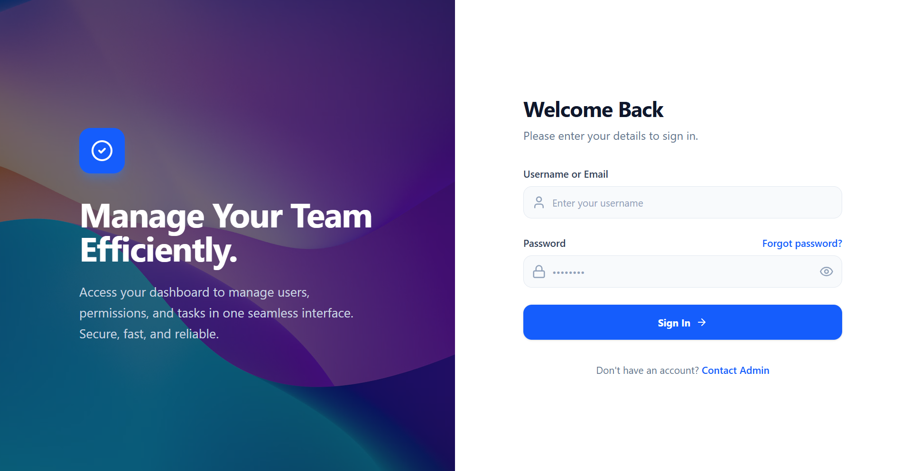
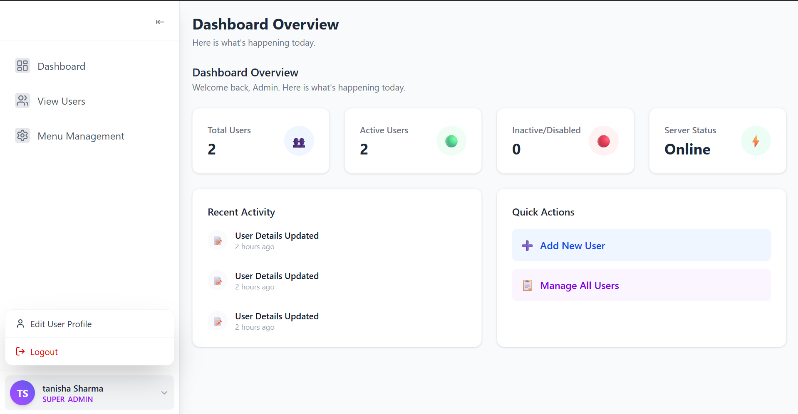
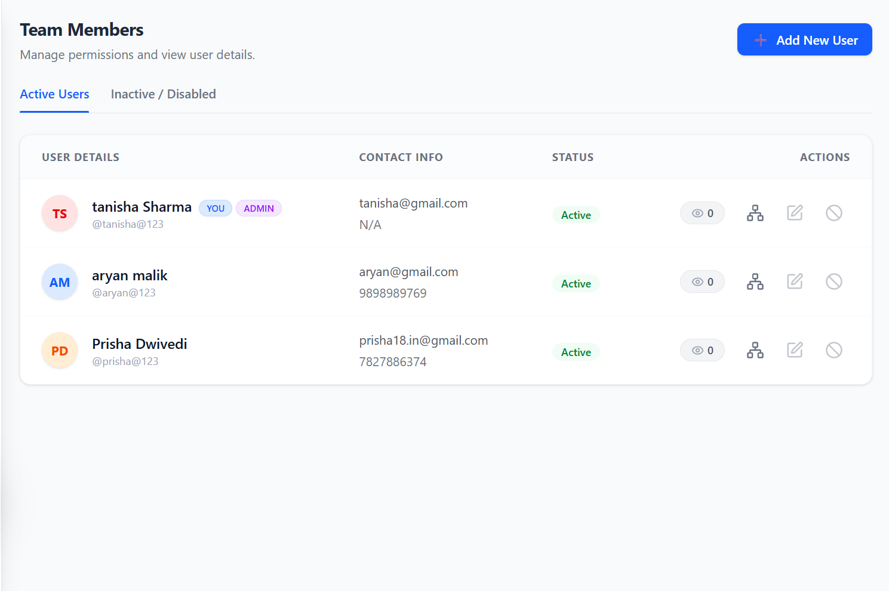
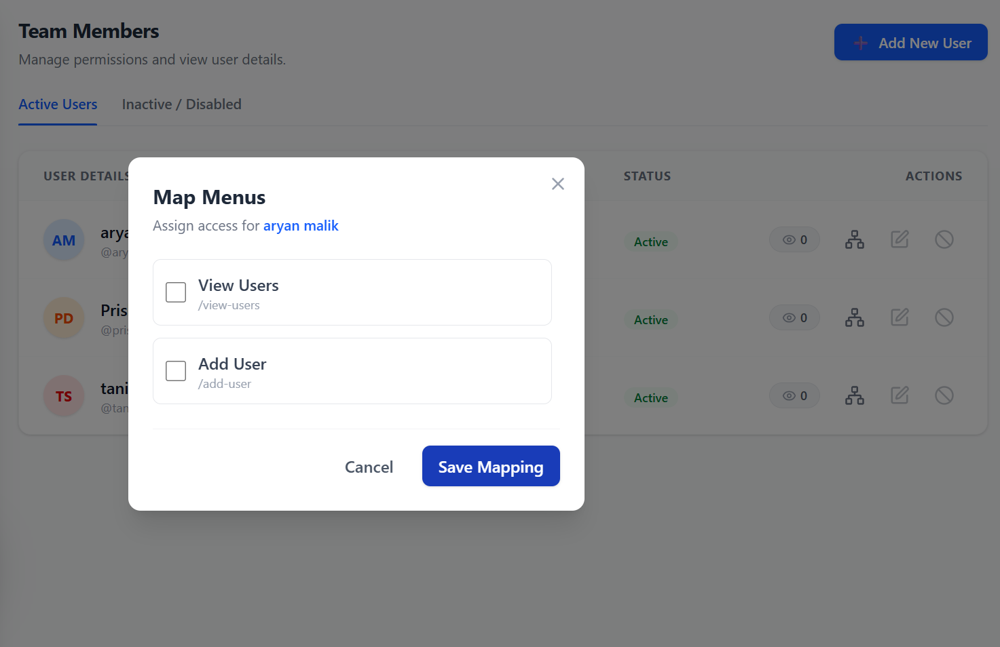
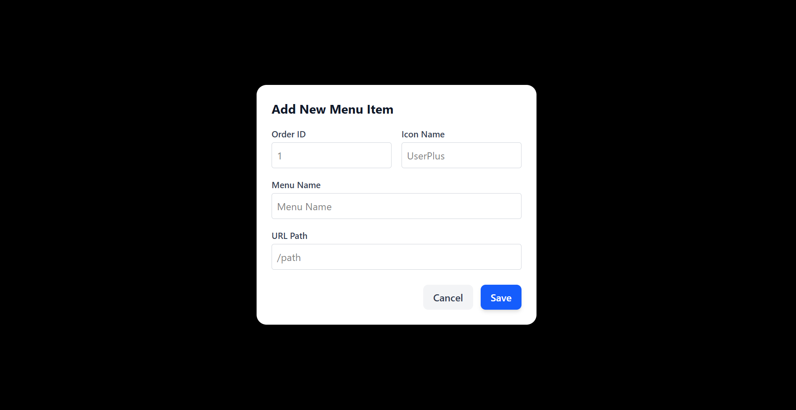

# Organizational Access Control

A full-stack login and user management application with JWT-based authentication, built with a **Spring Boot** backend and a **React + Vite** frontend. Administrators can create and manage users, enable or disable accounts, and control which menu items each user can access.

## Screenshots

<!-- Replace these with real screenshots. Create a docs/ folder in the repo, add images there, and update the paths. -->

| Login | Dashboard |
|-------|-----------|
|  |  |

| User Management | Menu Assignment |
|-----------------|-----------------|
|  |  |

| Add Menu |
|----------|
|  |

## Features

- JWT-based login and API authentication
- Forgot password and reset password flow using time-limited reset tokens
- Create, update and delete users
- Enable or disable user accounts
- Menu management and per-user menu assignment
- Login history tracking
- Dashboard and user profile pages
- Toast notifications for user feedback

## Tech Stack

| Layer | Technologies |
|-------|--------------|
| Backend | Java 17, Spring Boot 3.4, Spring Security, Spring Data JPA, JWT, Thymeleaf, Gradle |
| Database | PostgreSQL |
| Frontend | React 19, Vite, Tailwind CSS, React Router, React Toastify |

## Project Structure

```
Organizational-Access-Control/
├── backend/     Spring Boot application (Gradle)
│   ├── src/main/java/...                   Controllers, services, repositories, models, security
│   └── src/main/resources/application.properties
└── frontend/    React + Vite application
    ├── src/                                 Pages and components
    └── vite.config.js
```

## Getting Started

### Prerequisites

- Java 17 or later
- PostgreSQL
- Node.js and npm

### 1. Set up the database

Create an empty PostgreSQL database:

```sql
CREATE DATABASE login_demo;
```

The schema is created and updated automatically on startup (`spring.jpa.hibernate.ddl-auto=update`).

### 2. Set environment variables

The backend reads its secrets from environment variables, so no credentials are stored in the repository.

| Variable | Description | Default |
|----------|-------------|---------|
| `DB_USERNAME` | PostgreSQL username | `postgres` |
| `DB_PASSWORD` | PostgreSQL password | none, required |
| `JWT_SECRET` | Secret used to sign JWTs (at least 32 characters) | none, required |

**Windows (Command Prompt):**
```
set DB_PASSWORD=your_db_password
set JWT_SECRET=your_secret_key_at_least_32_characters_long
```

**Windows (PowerShell):**
```
$env:DB_PASSWORD="your_db_password"
$env:JWT_SECRET="your_secret_key_at_least_32_characters_long"
```

**macOS / Linux:**
```
export DB_PASSWORD=your_db_password
export JWT_SECRET=your_secret_key_at_least_32_characters_long
```

If you run the project from an IDE, add these variables to the run configuration instead.

### 3. Run the backend

From the `backend/` folder, in the same terminal where you set the variables:

```
./gradlew bootRun
```

On Windows Command Prompt, use `gradlew bootRun`.

The API is available at `http://localhost:8080/api`.

### 4. Run the frontend

From the `frontend/` folder:

```
npm install
npm run dev
```

Open `http://localhost:5173`.

## API Endpoints

All endpoints are under the `/api` context path.

### Authentication

| Method | Endpoint | Description |
|--------|----------|-------------|
| POST | `/api/login-new` | Log in and receive a JWT |
| POST | `/api/forgot-password` | Request a password reset |
| POST | `/api/reset-password` | Reset password using a token |

### Users

| Method | Endpoint | Description |
|--------|----------|-------------|
| POST | `/api/create` | Create a user |
| GET | `/api/all` | List all users |
| GET | `/api/byid/{id}` | Get a user by ID |
| PUT | `/api/update` | Update a user |
| DELETE | `/api/delete/{id}` | Delete a user |
| PUT | `/api/{id}/disable` | Disable a user |
| PUT | `/api/enable?id={id}` | Enable a user |

### Menus

| Method | Endpoint | Description |
|--------|----------|-------------|
| GET | `/api/menus` | Get all menu items |
| GET | `/api/menu/all` | Fetch all menu items |
| POST | `/api/menu/create` | Create a menu item |
| GET | `/api/users/{userId}/menus` | Get menus assigned to a user |
| POST | `/api/users/{userId}/menus` | Assign menus to a user |

## Frontend Routes

| Route | Page |
|-------|------|
| `/login` | Login |
| `/forgot-password` | Request password reset |
| `/reset-password` | Reset password |
| `/dashboard` | Main dashboard |
| `/view-users` | User list |
| `/add-user` | Add a new user |
| `/menus` | Menu management |
| `/profile` | User profile |

## Running Tests

From the `backend/` folder:

```
./gradlew test
```

## Notes and Limitations

- The password reset flow is a demo: the reset link is printed to the backend console instead of being emailed.
- The frontend stores login details in `localStorage`. This is simple but exposes the token to XSS attacks, so a production app should consider httpOnly cookies.
- `ddl-auto=update` is convenient for development. Use a migration tool such as Flyway or Liquibase for production.

## Author

**Prisha Dwivedi** · [GitHub](https://github.com/prisha-011)
